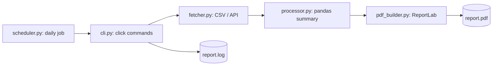

# PDF Report Automation Tool

Production-style Python CLI that **fetches data** (CSV or REST API), **processes** it with pandas, **builds a PDF report** with ReportLab (metrics, bar chart, table) and can **run automatically on a daily schedule**. Packaged with `pyproject.toml`; installs a `report` command.

## Features
- CSV or JSON API source (works with the FastAPI JWT service, using a Bearer token)
- pandas cleaning and per-category summary
- PDF with key metrics, bar chart and table
- `argparse`-style CLI built with **click**
- Daily scheduling with `schedule`
- Execution logs written to `report.log`
- Unit tests with pytest

## Install
```bash
python -m venv .venv
source .venv/bin/activate        # Windows: .venv\Scripts\activate
pip install .                    # or: pip install -e ".[dev]"
```

## Usage
```bash
# One-off report from CSV
report generate --source sample_data/sales.csv --out output/sales_report.pdf --title "Sales Report"

# From the Task 05 API (get a token via /auth/login)
export REPORT_API_TOKEN="<jwt>"
report generate --source http://127.0.0.1:8000/items/ --out output/items_report.pdf

# Run every day at 09:00 (and once right now)
report schedule --source sample_data/sales.csv --daily 09:00 --out-dir reports --run-now

report --help
```
Expected data columns: `category`, `amount` (extra columns such as `date` are ignored).

## Architecture


## Project layout
```
src/report_tool/   cli.py  fetcher.py  processor.py  pdf_builder.py  scheduler.py
tests/             unit tests
sample_data/       sales.csv
pyproject.toml     packaging + `report` entry point
```

## Tests
```bash
pip install -e ".[dev]" && pytest -q
```
